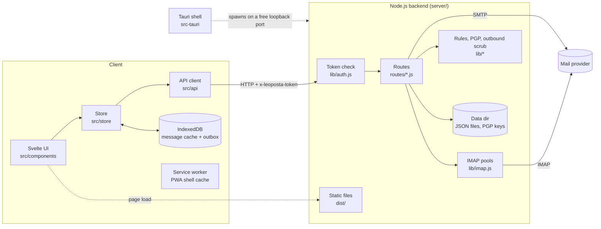

# Architecture

Leoposta is a mail client in two parts: a Svelte single-page app (PWA) and a small
Node.js backend that talks IMAP/SMTP on its behalf. Browsers cannot open IMAP or SMTP
sockets, so the backend is not optional. The same two parts ship in three ways:
a dev setup, a [container image](docs/running-in-a-container.md), and a Tauri desktop app.

## Layout

| Path | What lives there |
|------|------------------|
| `src/` | Frontend: `components/` (Svelte), `store/` (state), `api/` (typed fetch client), `lib/` (pure helpers such as `sanitizeHtml.ts`, `offlineQueue.ts`), `__tests__/` (Vitest) |
| `server/` | Backend: `index.js` (wiring), `routes/` (one file per API area), `lib/` (IMAP pools, auth, PGP, rules, sanitising, state), `*.test.js` (node:test) |
| `src-tauri/` | Desktop shell (Rust) that starts the bundled backend on a free loopback port |
| `tests/e2e/`, `tests/screenshots/` | Playwright journeys and README screenshot generation, both against a local fictional IMAP server |
| `scripts/` | `dummy/imap.cjs` (test IMAP server), `bundle-backend.sh` (desktop bundle), `container-smoke.sh` (image check) |
| `container/`, `Dockerfile` | Container image definition and entrypoint |
| `docs/` | [Index](docs/README.md), [decision records](docs/adr), [glossary](docs/glossary.md) |
| `.github/` | CI, image and release workflows, Dependabot, templates |

## Components

## Data flow: reading and sending mail

1. The browser loads the built app from the backend's static `dist/` folder (or from
   Vite in development). The service worker caches the app shell.
2. The UI asks the store for a folder; the store calls the API client, which sends
   `GET /api/messages` with the `x-leoposta-token` header and an `x-account` header
   that selects the account.
3. The backend checks the token in constant time ([auth.js](server/lib/auth.js)),
   resolves the account, reuses a pooled IMAP connection and returns message summaries.
4. Opening a message fetches the body. The frontend sanitises the HTML before rendering
   ([sanitizeHtml.ts](src/lib/sanitizeHtml.ts)); remote images stay blocked until allowed.
5. Fetched messages (list rows and full bodies) are written to IndexedDB so reading works offline.
6. Sending posts to `/api/send`; the backend scrubs outbound HTML ([sanitize.js](server/lib/sanitize.js)). Offline, the message waits in the IndexedDB outbox
   and is sent when the connection returns. Scheduled mails are stored by the backend
   (`scheduled.json`) and sent by a 30-second timer.
7. `GET /api/idle` is a server-sent-event stream that pushes new-mail notices.

## Persistence and secrets

All backend state is JSON plus PGP key files in one data directory
(`LEOPOSTA_DATA_DIR`, default `server/`). Files are git-ignored and written with mode
0600. Passwords can come from environment variables instead. The full table is in the
[README](README.md#credentials).

## Decisions

See [docs/adr](docs/adr): why a separate backend, how the desktop app runs it, the
token scheme, offline-first storage and the container image design.
