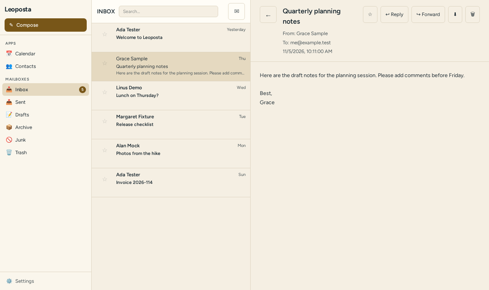
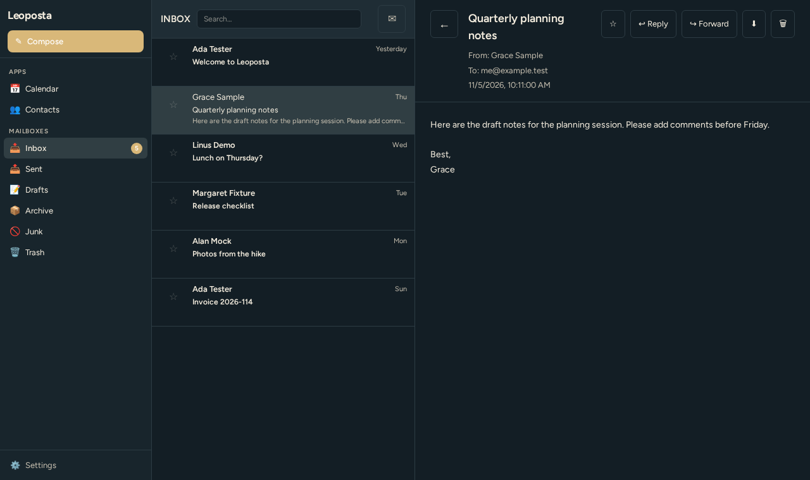

# Leoposta

A modern, web-based mail client with a clean, familiar native-mail UX.




Screenshots show the real UI against a fictional fixture mailbox and are
regenerated with `npm run screenshots`.

Documentation: [ARCHITECTURE.md](ARCHITECTURE.md), [docs index](docs/README.md), [decision records](docs/adr), [glossary](docs/glossary.md).

## Features

- IMAP/SMTP with multiple accounts
- Attachments on compose, signature, scheduled send
- Offline cache and send queue (service worker + IndexedDB)
- Filter rules, virtualised message list, light and dark theme
- Sanitised HTML mail, remote images blocked by default
- Installable PWA; a Tauri desktop wrapper is configured (see Status)

## Status

Verified on the current default branch by running the commands in the last column.

| Area | State | Verified by |
|------|-------|-------------|
| Unit tests (Vitest) | 66 passing | `npm test` |
| Server tests (node:test) | 54 passing | `npm run test:server` |
| End-to-end (Playwright, Chromium) | 3 passing | `npm run test:e2e` |
| Typecheck, production build | clean | `npm run typecheck`, `npm run build` |
| Dependency audit | runtime clean; build-time findings documented | [SECURITY.md](SECURITY.md) |
| Desktop (Tauri) builds | release workflow exists, not verified here | [release.yml](.github/workflows/release.yml) |
| Published releases | none yet | [CHANGELOG.md](CHANGELOG.md) |

## Run it on Fedora and Debian

A container image is built by [CI](.github/workflows/image.yml) for amd64 and arm64
and attached to the `latest-image` release, so no registry login is needed.

```bash
curl -LO https://github.com/LeonardSchwier/leoposta/releases/download/latest-image/leoposta-image-linux-amd64.tar.gz
podman load -i leoposta-image-linux-amd64.tar.gz      # Fedora; on Debian: docker load -i ...
podman run -d --name leoposta -p 127.0.0.1:3001:3001 -v leoposta-data:/data \
  ghcr.io/leonardschwier/leoposta:latest               # on Debian: docker run ...
```

Then open <http://localhost:3001>. Ports, volume, environment variables, the arm64
download and the verification record are in
[docs/running-in-a-container.md](docs/running-in-a-container.md).

## Tech Stack

- **Frontend**: Svelte 5, TypeScript, Tailwind CSS
- **Backend**: Node.js, Express, ImapFlow, Nodemailer
- **Build**: Vite

## Getting Started

### Prerequisites

- Node.js 18+ (CI and the container use 22)
- npm 9+

### Installation

```bash
# Clone the repo
git clone https://github.com/LeonardSchwier/leoposta.git
cd leoposta

# Install dependencies
npm install

# Configure your mail account
# (via the Settings panel in the UI)

# Start the backend
npm run server

# Start the frontend (in a new terminal)
npm run dev
```

### Production Build

```bash
npm run build
npm run preview
```

## Credentials

What is stored where (all files live in `server/`, are git-ignored and written with mode 0600):

| File | Contents |
|------|----------|
| `account.json` | Account settings including the IMAP and SMTP passwords in plain text (unless supplied by environment, see below) |
| `scheduled.json` | Queued scheduled mails: recipients, bodies, attachments |
| `pgp_private.asc` | Your PGP private key (stays passphrase protected if it was imported that way) |

The PGP passphrase is never stored; unlock the key at runtime with `POST /api/pgp/unlock` (kept in memory for 15 minutes). An old `pgp_passphrase.txt` is ignored; delete it.

To keep passwords out of `account.json`, set `LEOPOSTA_IMAP_PASS` and/or `LEOPOSTA_SMTP_PASS` in the server environment. They override the file value and are never written back.

## API authentication

Every `/api` route except `GET /api/health` requires the header
`x-leoposta-token`. Set `LEOPOSTA_TOKEN` for the server; if unset, a random
token is generated and printed once at start. Give the frontend the same value
through `VITE_LEOPOSTA_TOKEN` at build time. (`GET /api/idle` and attachment
downloads also accept `?token=` because browsers cannot set headers there.)

## API Endpoints

| Method | Endpoint | Description |
|--------|----------|-------------|
| GET | `/api/messages?folder=INBOX&limit=50` | List messages |
| GET | `/api/message/:id?folder=INBOX` | Get single message |
| POST | `/api/account` | Configure mail account |
| POST | `/api/send` | Send or schedule email |

## Development

### Testing

```bash
# Unit tests
npm test

# E2E tests
npm run test:e2e
```

### Code Quality

```bash
# Type check
npm run typecheck
```

See [CONTRIBUTING.md](CONTRIBUTING.md) for the workflow and [SECURITY.md](SECURITY.md) to report a vulnerability.

## Why this repository is best practice

- **Tests prove behaviour, at three levels.** Unit, server and browser journeys run on every push: [ci.yml](.github/workflows/ci.yml), [tests/e2e](tests/e2e/mail.spec.ts).
- **A browser test fails on any console error.** Silent runtime errors cannot ship: [fixtures.ts](tests/e2e/fixtures.ts).
- **The test mailbox is local and fictional.** No real account or network is needed: [imap.cjs](scripts/dummy/imap.cjs), [seed.json](tests/e2e/seed.json).
- **Types are checked in CI.** Type errors fail the build: [package.json](package.json).
- **Untrusted mail HTML is sanitised and tracking is blocked.** [sanitizeHtml.ts](src/lib/sanitizeHtml.ts), tested in [sanitizeHtml.test.ts](src/__tests__/sanitizeHtml.test.ts).
- **The local API requires a token, compared in constant time.** [auth.js](server/lib/auth.js).
- **The desktop shell has a strict content security policy.** [tauri.conf.json](src-tauri/tauri.conf.json), asserted in [tauriConf.test.ts](src/__tests__/tauriConf.test.ts).
- **Secrets stay out of git and files are mode 0600.** What is stored where is documented: [Credentials](#credentials), [.gitignore](.gitignore).
- **Workflow actions are pinned to commit SHAs with least-privilege permissions.** [ci.yml](.github/workflows/ci.yml), [release.yml](.github/workflows/release.yml).
- **Dependencies are updated monthly and audited.** [dependabot.yml](.github/dependabot.yml), [SECURITY.md](SECURITY.md).
- **The API surface is snapshot-tested.** An accidental route change fails a test: [routes.snapshot.test.js](server/routes.snapshot.test.js).
- **Design tokens come from one shared package, not copies.** [@leonardschwier/leoforma](package.json) tokens are mapped in [app.css](src/app.css); components stay local because they are Svelte.
- **Process is documented and honest.** [ROADMAP.md](ROADMAP.md), [CONTRIBUTING.md](CONTRIBUTING.md), [CHANGELOG.md](CHANGELOG.md), [PR template](.github/pull_request_template.md).

## License

MIT
